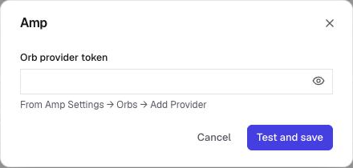

# Amp orbs on sbx

For an owner who wants [Amp](https://ampcode.com) threads to run in sbx
sandboxes: sbx becomes a self-hosted orb provider. Onboard the repository in
sbx first; Amp uses the same recipe. How the connector works, routing and
snapshots are in [Amp](../amp-orbs.md). Amp's pages may differ a little from
the labels below.

## Create the provider

In the Amp web app:

1. Open **Settings → Orbs** and add a **self-hosted** provider.
2. Turn **Repository Setup** off: sbx checks the repository out itself, at
   `/home/user/workspace/repo`, with renewable git credentials.
3. Add an orb type for each repository the provider serves. On the server,
   `sbx-admin amp routes` lists the orb type name for each repository (a slug
   of `owner/repo`). With one repository you can skip this: sbx runs it for
   threads without an orb type.
4. Copy the provider token Amp shows. Never paste it into a chat or onto a
   command line.

## From the Amp CLI

Instead of step 1 and 4, the Amp CLI creates the provider:

```sh
amp orb provider create NAME                # a provider of your own
amp orb provider create NAME --workspace    # a provider for the workspace
```

It saves the token with Amp's credentials instead of printing it, so it gives
you no token to paste into sbx: to connect sbx, create the provider in the web
app (steps 1 to 4) instead. Orb types (step 3) are set in the Amp web app
either way, under the provider in Settings → Orbs.

## Give the token to sbx

Every sandbox template already contains Amp, so adding the token rebuilds
nothing. Paste it in one of these places, after the first-run setup:

- **The keys page** your agent sends you (`https://app.<domain>/keys/…`),
  next to any other keys it needs. Amp stays on and its provider starts.
- **Extensions** in the web app: **Add key** (or **Set up**) on Amp's row, paste the provider token and choose
  **Test and save**. Saving turns Amp on; **Disconnect** in its row's menu
  turns it off.

  

- On the server, with the token on stdin:

  ```sh
  read -r -s AMP_TOKEN
  printf '%s\n' "$AMP_TOKEN" | sbx-admin connect amp provider_token=-
  unset AMP_TOKEN
  ```

Saving installs the Amp CLI on the server if it is missing and starts the
`sbx-amp` service. Run one provider controller per token: do not start
another `amp orb provider` next to it.

## Check the connection

A running `sbx-amp` alone does not prove Amp accepted the token. Check both
sides:

1. In Amp **Settings → Orbs**, the provider shows as connected.
2. Start one thread on it and watch a sandbox appear in sbx:

   ```sh
   amp -ox "say hi" --orb-provider NAME
   sbx ls
   ```

Orb sandboxes belong to the installation's first admin, so run `sbx ls`
signed in as them. If no sandbox appears, `journalctl -u sbx-amp -n 50` on
the server shows why, and **Test** in Amp's row menu under **Extensions** runs
sbx's checks.
Delete test threads in Amp while the provider is connected; archiving a
thread only pauses its sandbox.
