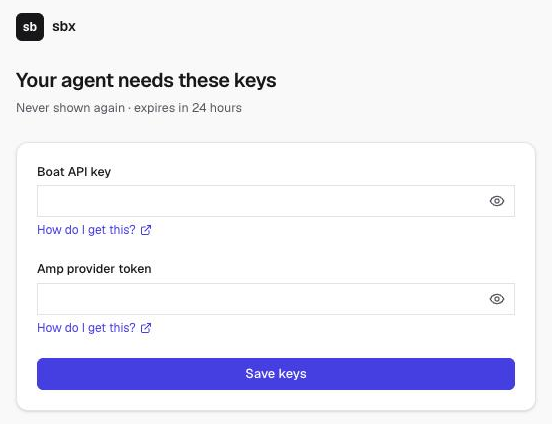

# Boat for sbx

For an owner whose sandboxes run at [Boat](https://docs.boat.dev) (the `boat`
runtime) instead of on the server itself. sbx needs a Boat API key and a
domain (see [Cloudflare DNS](cloudflare.md)): Boat's sandboxes call the
server back at `login.D`. Boat's dashboard may differ a little from the
labels below.

## API key

1. Sign in at [boat.dev/dashboard](https://boat.dev/dashboard).
2. Open **API keys** and create a key with the scope **`full-sandbox`**. It
   starts with `boat_`. Copy it once.
3. Never paste it into a chat or onto a command line. Paste it on the keys
   page your agent sends you ([below](#add-it-to-sbx)). sbx checks it with
   Boat and keeps it in its secret store.

If the key has an expiry, sbx warns 14 days before it. Create a new key then
and add it again (below).

## Plan

Tell your agent the plan, so sbx sets its limits to match. As read from
Boat's [pricing](https://docs.boat.dev/pricing.md) on 2026-11-17:

| Plan | Per sandbox, at most | At once |
| --- | --- | --- |
| trial | 4 vCPUs, 8 GB | 2, stopped after 2 hours |
| `20` | 8 vCPUs, 16 GB, 111 GB disk | 100 |
| `100` | 16 vCPUs, 32 GB, 251 GB disk | 300 |
| `500` | 16 vCPUs, 32 GB, 251 GB disk | 1,000 |
| `2000` | 16 vCPUs, 32 GB, 251 GB disk | 2,000 |

The trial saves no snapshots, and sbx's templates are saved snapshots, so
templates build only after the first payment: pay in Boat's dashboard
(Billing), and the next build round builds them. Plan on `20` or above. The
[reference](../reference.md#boat-boat) has every setting.

## Add it to sbx

Your agent usually asks for the key on a **keys page**: it sends you a link
to your server (`https://login.<domain>/keys/…`). Sign in, paste the key into
its field and choose **Save keys**. sbx checks the key with Boat, stores it and
adds Boat; the page shows when the server has applied it. Each **How do
I get this?** link leads back here.

Other ways, with the key read from a file or stdin, never typed on a
command line:

- The web app: **Settings → Sandbox runtimes**, add Boat, paste the key and
  choose the plan. The first-run wizard offers the same.
- The `sbx` CLI, as an admin:
  `sbx runtimes add boat --plan 20 --secret BOAT_API_KEY < key-file`.
- On the server: `sbx-admin runtime add boat < key-file`.

`sbx runtimes test boat` then checks that Boat answers with the key and
names the plan. To replace a key: `sbx runtimes set boat --secret
BOAT_API_KEY < new-key-file`, or change it in Settings.

Untrusted public repositories can't be served while Boat is enabled: it has
no per-sandbox egress rules.
