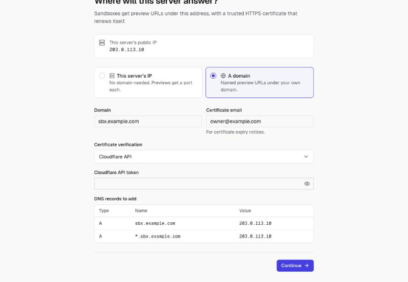

# Cloudflare DNS for sbx

For an owner whose domain's DNS is at Cloudflare. sbx runs at `login.D` and
serves previews at `<name>.D`, where `D` is a name you choose, usually a
subdomain such as `sbx.example.com`. Your coding agent tells you `D` and the
server's public IP. Cloudflare's dashboard changes from time to time, so the
labels below may differ a little from what you see.

## DNS records

In Cloudflare, adding the records is what creates the subdomain. Nothing else
needs to be set up first. In the zone's DNS records (for `sbx.example.com`,
the zone is `example.com`), add two records:

| Type | Name | Content | Proxy status |
| --- | --- | --- | --- |
| `A` | `sbx` (the domain `D` itself) | the server's public IP | DNS only |
| `A` | `*.sbx` (the wildcard `*.D`) | the server's public IP | DNS only |

Turn the proxy off (the grey cloud, "DNS only") on both:

- Cloudflare's free proxy certificate covers `example.com` and
  `*.example.com`, not a wildcard one level further down such as
  `*.sbx.example.com`, so proxied previews would fail with a TLS error.
- sbx issues its own certificate for `D` and `*.D` and serves it itself; the
  proxy would sit in front of it.

Leave TTL on Auto. Other DNS providers take the same two records; only the
proxy setting is Cloudflare's.

## API token

sbx answers Let's Encrypt's challenge through Cloudflare's API, so it needs a
token that may edit the zone's DNS. To create one (labels may differ):

1. **Profile → API Tokens → Create Token.**
2. Use the **Edit zone DNS** template.
3. **Zone Resources:** Include → Specific zone → your zone (`example.com`).
4. Optional: **Client IP Address Filtering** to the server's public IP, so
   the token works only from the server.
5. Leave **TTL** (the token's expiry) empty. sbx renews the certificate on
   its own every couple of months, and an expired token makes that renewal
   fail.
6. Create the token and copy it once; Cloudflare does not show it again.

If sbx reports that it can't find the zone, edit the token and add the
permission **Zone → Zone → Read** next to the template's DNS edit permission.

Never paste the token into a chat or onto a command line. Paste it in the
first-run setup's **Server address** step: choose **A domain**, then
**Cloudflare API** under **Certificate verification**. The same screen lists
the DNS records to add. sbx keeps the token in its secret store. To replace
it later, paste the new token in the web app's
**Settings → Domain & certificate**.



## Why sbx needs the token

Each preview has its own name under `D`, so sbx needs a wildcard certificate
for `*.D`. Let's Encrypt issues wildcard certificates only through the DNS-01
challenge: sbx publishes a TXT record at `_acme-challenge.D`, Let's Encrypt
reads it, and sbx removes it again. Certificates last 90 days and sbx renews
them about every 60 days, each time with a new TXT record, so the token has to
keep working for as long as the server runs.

## Delegated DNS

If you would rather give sbx no Cloudflare credential, choose `delegated`
instead of a token: sbx then answers the challenge with its own small DNS
server. Add the two `A` records above plus one more:

| Type | Name | Content |
| --- | --- | --- |
| `NS` | `_acme-challenge.sbx` | `sbx.example.com` (the domain `D`) |

The server must then accept inbound TCP and UDP on port 53, in any cloud
firewall too. The challenge is answered only while that port is reachable,
so a firewall change later breaks renewals.

## Check the records

Once the records are in, your agent checks them from outside:

```sh
dig +short login.D @1.1.1.1; dig +short anything.D @1.1.1.1   # both: the public IP
dig +short NS _acme-challenge.D @1.1.1.1                      # delegated only: D.
```

New records usually answer within minutes. On the server, `sbx-admin doctor`
and the Test button in **Settings → Domain & certificate** run the same
checks.
