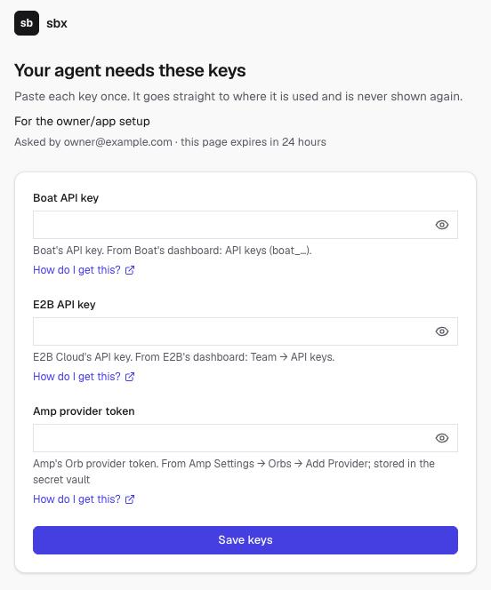

# E2B Cloud for sbx

For an owner whose sandboxes run at [E2B](https://e2b.dev) (the `e2b-cloud`
runtime) instead of on the server itself. sbx needs an API key of the E2B team
whose plan pays for the sandboxes, and a domain (see
[Cloudflare DNS](cloudflare.md)): E2B's sandboxes call the server back at
`app.D`. E2B's dashboard may differ a little from the labels below.

## API key

1. Sign in at [e2b.dev/dashboard](https://e2b.dev/dashboard), in the team
   that should pay.
2. Open **API keys** and create a key. Copy it once.
3. Never paste it into a chat or onto a command line. Paste it in the
   setup page's **Sandboxes** step, or later in sbx's own pages
   ([below](#add-it-to-sbx)). sbx checks it with E2B and keeps it in its
   secret store.

A key belongs to the team, and the plan's limits are the team's: several
installations on the same team share them.

## Plan

The setup adds E2B Cloud with Hobby's limits. On Pro, set the plan once the
setup is done, so sbx's limits match: **Settings → Sandbox runtimes**, or
`sbx runtimes set e2b-cloud --plan pro`. As read from
[E2B's pricing](https://e2b.dev/pricing) on 2026-11-17:

| Plan | Runs before an idle sandbox pauses | Per sandbox | At once |
| --- | --- | --- | --- |
| Hobby | 1 h | 8 vCPUs, 8 GiB, 10 GiB disk | 10 |
| Pro | 24 h | 8 vCPUs, 8 GiB, 20 GiB disk | 100 |

E2B charges per second while a sandbox runs. If E2B refuses something (a
longer timeout than the plan allows, too many at once), sbx says which
setting to change. The [reference](../reference.md#e2b-cloud-e2b-cloud) has
every setting.

## Add it to sbx

During the first-run setup, paste it in the setup page's **Sandboxes**
step: pick E2B Cloud and choose **Check key** ([the setup](setup.md#sandboxes)).
sbx checks the key with E2B, stores it and adds E2B Cloud.

On a server that runs sandboxes itself (Embed), that step has Embed chosen
already: choose **Also add a provider for more room**, pick E2B Cloud and
choose **Add E2B Cloud**. Embed stays the default; to start new sandboxes on
E2B Cloud, choose **Make default** next to it under **Settings**.

Later, an agent may ask for the key on a **keys page**: it sends you a link
to your server (`https://app.<domain>/keys/…`). Sign in, paste the key into
its field and choose **Save keys**; the page shows when the server has
applied it. Each **How do I get this?** link leads back here.

Other ways, with the key read from a file or stdin, never typed on a
command line:

- The web app: **Settings → Sandbox runtimes**, add E2B Cloud, paste the key
  and choose the plan.
- The `sbx` CLI, as an admin:
  `sbx runtimes add e2b-cloud --plan hobby --secret E2B_CLOUD_API_KEY < key-file`.
- On the server: `sbx-admin runtime add e2b-cloud < key-file`.

`sbx runtimes test e2b-cloud` then checks that E2B answers with the key. To
replace a key: `sbx runtimes set e2b-cloud --secret E2B_CLOUD_API_KEY <
new-key-file`, or change it in Settings.
