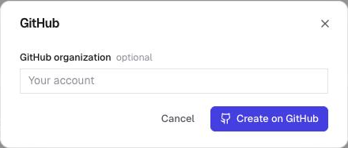

# GitHub for sbx

sbx clones and pushes private repositories through a GitHub App of its own,
which also gives sandboxes the `gh` CLI and pull-request previews. Each
installation creates its own App from the web app; there is no shared App and
no key to copy. GitHub's pages may differ a little from the labels below.

## Create the App

1. Sign in to the sbx web app as an admin, open **Extensions**, and click
   **Set up** on the **GitHub** row.
2. Enter the GitHub organization that owns the repositories, or leave it
   empty for your own account. Creating an App in an organization needs its
   owner's rights there.
3. Click **Create on GitHub**. GitHub shows the App sbx asks for, with the
   permissions it needs (contents and pull requests: read and write; metadata:
   read) and the push and pull-request events. Confirm it.

GitHub then goes straight on to installing it.

## Select repositories

On GitHub's install page for the new App:

1. Choose the account or organization to install it on.
2. Choose **Only select repositories** and pick the repositories sbx should
   serve, or **All repositories**.
3. Install. GitHub sends you back to the web app.

To add repositories later, open the App's installation settings on GitHub
(**Manage on GitHub** in the GitHub row's menu, the repository page's
**Install the GitHub App** button, or the link in the failing check opens it) and add them there. A repository the App is
not installed on shows "Install the GitHub App on this repository" as its
first step in sbx.

## Check it

In **Extensions**, open the GitHub row's menu (**⋯**) and click **Test**. Each
check should pass:

- **App**: GitHub accepts the App's key.
- **installations**: the accounts it is installed on.
- **URLs**: the App points at this server's address. After a domain change,
  create the App again.
- **access to `owner/repo`**: one line for each repository sbx serves.

On the server, `sbx-admin doctor` runs the same checks.

An operator can instead give an existing App's values or a deploy key
through the API or CLI: `sbx extensions set github --set id=... --secret pem`
(fields `id`, `slug`, `client_id`; secrets `pem`, `webhook_secret`,
`client_secret`, `deploy_key`).
