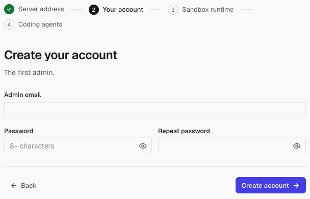
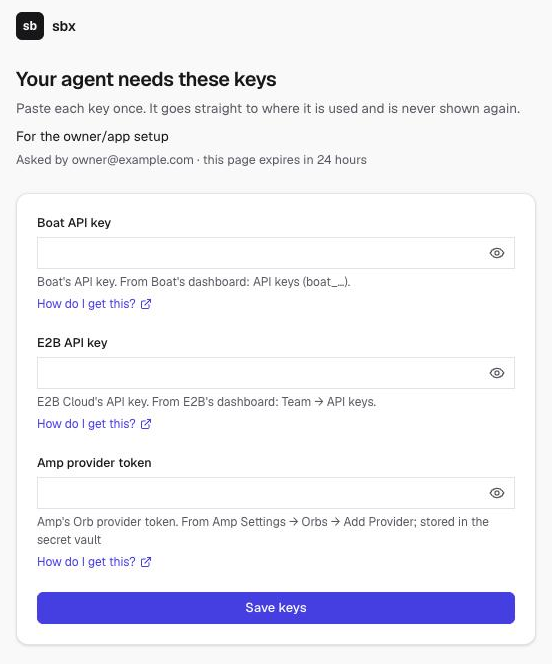
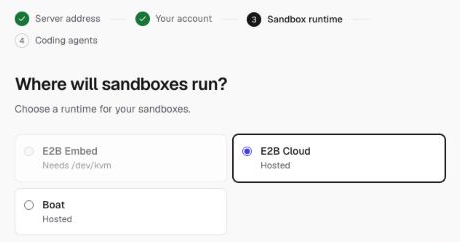

# Your sbx server's first-run setup

Your agent installs sbx on your server and then sends you two links: the
**setup link**, where you create your account, and a **keys page**, where you
paste the keys only you have. This page shows what each one looks like. Your
agent does the rest of the setup from its side. The setup link is the
onboarding link the installer prints as its last line
(`==> Open the onboarding: https://.../app/setup#t=...`); if you ran the
installer yourself, open that one.

## Create your account

The setup link opens the first-run setup at the **Your account** step. Enter
your email and a password of your own; that signs you in. You are the first
admin. Your agent never sees the password: it signs in through your browser
with `sbx login` afterwards.

If you set up a domain yourself, the **Server address** step comes first: it
asks for the domain and lists its three DNS records, and port 53 must be open;
see [Cloudflare DNS for sbx](cloudflare.md#dns-records). It needs no email.

## Paste your keys

The keys page lists every key your agent needs in one form: your sandbox
runtime's API key, an agent's token, values your app needs. Sign in, paste
each key once and choose **Save keys**. Each key goes straight to where sbx
uses it and is never shown again. **How do I get this?** under a field opens
the guide for that key ([E2B](e2b.md), [Boat](boat.md), [Amp](amp.md)).

After you save, the page shows when the server has applied runtime keys; you
can close it then. A key sbx refuses is marked under its field: fix it and
save again. The link works for 24 hours unless your agent chose otherwise; ask
it for a new one after that.

## Sandbox runtime

Your agent normally fills in this step for you; you can also do it on the
setup page. **Sandbox runtime** is where sandboxes run: E2B Embed on this
server (it needs `/dev/kvm`), or a hosted one such as E2B Cloud or Boat. A
Boat key sets its plan from your Boat account; a key still on Boat's free
trial is refused ([why](boat.md#plan)).

There is no coding-agent step: every sandbox template has every coding
agent. You connect the ones your team uses after the setup, under
**Extensions**: Amp's self-hosted orb provider ([Amp](amp.md)) and Claude
Code's self-hosted environment; Codex needs nothing.

The first template builds start once the address and the sandbox runtime are
chosen and take about 10 minutes; you can finish the setup while they run.
